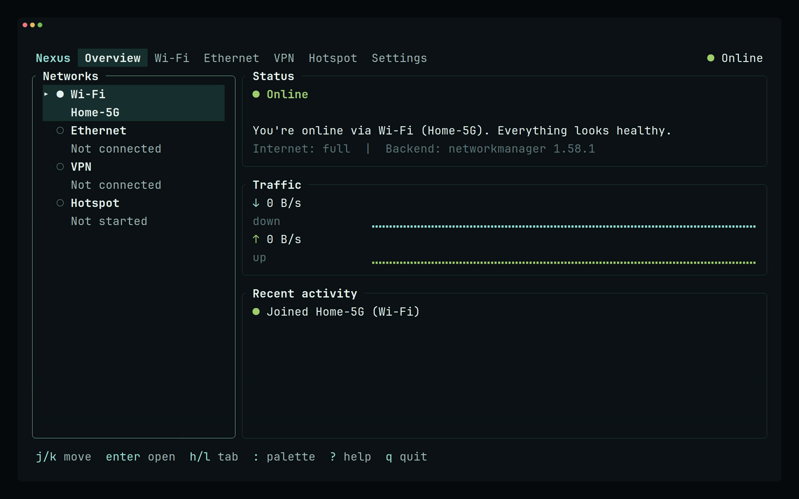

<div align="center">


# Nexus

**Every network you can join, from your terminal.**

A keyboard-first TUI, CLI and launcher menu for NetworkManager on Wayland desktops.<br>
Wi-Fi, Ethernet, VPNs, hotspot and tethering, run by a user daemon that never needs root.

[](https://github.com/CPT-Dawn/Nexus/releases/latest)
[](https://github.com/CPT-Dawn/Nexus/actions/workflows/ci.yml)
[](https://aur.archlinux.org/packages/nexus-nm-bin)
[](LICENSE)

[Install](#install) · [Quick start](#quick-start) · [Documentation](docs/README.md) · [Contributing](CONTRIBUTING.md)


<sub><a href="assets/demo.mp4">Watch in full quality</a></sub>

</div>

## Why Nexus

- **Every network in one place.** Wi-Fi up to WPA3 and eduroam-style sign-in, Ethernet with 802.1X, WireGuard and plugin VPNs, a hotspot with a QR code, and Bluetooth tethering.
- **It tells you why you're offline.** `nexus doctor` checks NetworkManager, your gateway and DNS, then lists the fixes in order. Behind a café login page, <kbd>o</kbd> opens it.
- **Edits that can't strand you.** A change to the network you're on (static IP, DNS, MAC) runs under a NetworkManager checkpoint. It rolls back after 15 seconds unless you keep it.
- **Your bar, your launcher, your scripts.** `nexus status --waybar --follow` feeds Waybar, `nexus menu` drives fuzzel, walker, rofi or tofi, every read takes `--json`, and every failure has its own exit code.
- **Runs as you and idles at zero.** The daemon is a systemd user service that polkit authorizes, never root. Idle, it uses 0.000% CPU and stays under 15 MiB, and CI fails any change that breaks those budgets. No telemetry, no update checks.

## Install

```sh
paru -S nexus-nm-bin
```

<details>
<summary>Other ways to install</summary>

**AUR, built from source**

```sh
paru -S nexus-nm
```

**From source** (needs Rust 1.90 or newer)

```sh
cargo install --locked --git https://github.com/CPT-Dawn/Nexus nexus
```

A `cargo install` build needs the systemd units set up by hand: [docs/installation.md](docs/installation.md) has the steps. Tarballs for x86_64 and aarch64 are on the [Releases](https://github.com/CPT-Dawn/Nexus/releases/latest) page.

</details>

Nexus needs **NetworkManager** as your network service and works alongside it. Already on iwd or systemd-networkd? NetworkManager can keep iwd as its Wi-Fi backend, and `nexus doctor` lists the switch-over steps.

## Quick start

```sh
systemctl --user enable --now nexus.socket   # the package enables it at your next login
nexus
```

1. Press <kbd>2</kbd> for the Wi-Fi tab, move with <kbd>j</kbd>/<kbd>k</kbd> and press <kbd>Enter</kbd> to join. A prompt asks for the password.
2. Press <kbd>:</kbd> and type what you want, such as `airplane` or `share`. The palette finds every action by name.
3. Changed your mind? <kbd>u</kbd> undoes a Wi-Fi or hotspot change from its toast.

<kbd>?</kbd> lists every key. For the CLI, `nexus --help` and `man nexus` cover each command.

## Documentation

| Guide | What it covers |
| --- | --- |
| [Installation](docs/installation.md) | AUR, from source, the systemd units, uninstalling |
| [CLI and scripting](docs/cli.md) | Every command, `--json`, Waybar, the launcher menu |
| [Keybindings](docs/keybindings.md) | Every key in the TUI, tab by tab |
| [Configuration](docs/configuration.md) | Every `config.toml` option, its default, and themes |
| [Permissions](docs/polkit.md) | What polkit allows, and the optional rule |
| [Troubleshooting](docs/troubleshooting.md) | The errors people hit, each with its fix |
| [Socket API](docs/ipc.md) | The JSON-lines protocol for writing your own front end |
| [Changelog](CHANGELOG.md) | What changed in each release |

## Contributing

Bug reports, ideas and pull requests are welcome. [CONTRIBUTING.md](CONTRIBUTING.md) has the setup, the checks CI runs, the fake-NetworkManager demo and how the GIF is recorded.

## License

[MIT](LICENSE) © CPT Dawn
